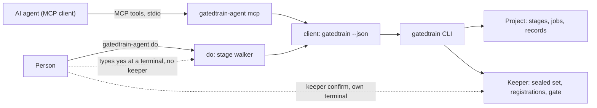

# gatedtrain-agent

Drivers for [gatedtrain](https://github.com/gatedtrain/gatedtrain) AI-native projects (`gatedtrain>=0.5,<0.6`). They
let an AI agent, or a person, run a project from the first stage to the report. The drivers themselves offer no
way to weaken a gate. Some checks here are cooperative; see "What gatedtrain guarantees" below.

There are two drivers and one skill:

- `gatedtrain-agent do <root>` walks a project's stages in pipeline order and stops, in plain words, where a person is
  needed.
- `gatedtrain-agent mcp` serves nine MCP tools over stdio, so an MCP client such as Claude Code can create, plan, run,
  wait on, inspect and report a project.
- An operator skill (a `SKILL.md`) tells an agent how to use the tools and when to stop and ask the person.

The drivers hold no trust logic. They call gatedtrain only through its `--json` command line, read only the JSON it
prints, and never import its code. The keeper, the sealed set, the registrations, alpha and the gate stay in
gatedtrain.

It is a prototype (preview): it calls no language model itself, and it only walks the stages in order.

## How it works



Solid arrows are what the drivers do. The dotted arrows are the person's own steps; no tool and no command of this
package runs them for the person:

- `gatedtrain keeper confirm <root> --decision <file>` is typed by the person, on a project with a keeper.
- For a project without a keeper, the person types `yes` at the terminal prompt of `do`.

## Install

The package is not on PyPI yet. Install it from this repository at a release tag, into the environment that holds
the `gatedtrain` you use:

```sh
pip install "gatedtrain-agent @ git+https://github.com/gatedtrain/gatedtrain-agent@v0.1.0"
```

This installs `gatedtrain>=0.5,<0.6`, the MCP Python SDK (`mcp>=2.3,<3`) and `pyyaml>=6`.
CPython 3.12 or 3.13, Linux.

The drivers run `python -m gatedtrain` with their own interpreter. To use another command, set
`GATEDTRAIN_AGENT_CLI` to a JSON array of strings, the argv prefix, for example `["/opt/venv/bin/gatedtrain"]`. Any
other value is an error naming the variable.

## `do`: one command for a person

```sh
gatedtrain-agent do <root>
gatedtrain-agent do <root> --goal "..." --data data.jsonl --pipeline pipeline.yaml [--keeper <socket>] [--gpu-hours N]
```

With `--goal`, `--data` and `--pipeline` (all three, or none) it creates the project first. Then it runs every stage
that is not done, in the order of `<root>/pipeline.yaml`, with the plan's defaults, and prints one line per stage. A
last `project report` prints the report path and the gate status.

| Exit code | Meaning |
|---|---|
| 0 | The gate passed. |
| 1 | The gate did not pass (FAIL or INCONCLUSIVE). The report is still written. |
| 2 | Usage error, for example only some of `--goal`, `--data` and `--pipeline` were given. |
| 3 | gatedtrain refused a command. gatedtrain's problems are printed. |
| 4 | A person is needed. The message says what to do. |

It stops with exit 4 in these cases:

- The data is too small for a conclusive result (`data_too_small`). Pass `--accept-inconclusive` to accept it; the
  result is then reported INCONCLUSIVE, not a PASS. Without the flag `do` never accepts.
- The deciding metric needs confirming (`confirm_metric`):
  - Without a keeper, `do` prints the plan's sentence and asks you to type exactly `yes`. It asks only at a terminal;
    piped input, CI or anything but `yes` stops with exit 4.
  - With a keeper, `do` writes the decision file `<root>/agent/decisions/<stage>.json`
    (`preregister` in the shipped packs) and tries the stage. If gatedtrain refuses
    for a missing confirmation, `do` prints the command for you to run yourself and exits 4:

    ```sh
    gatedtrain keeper confirm <root> --decision <root>/agent/decisions/<stage>.json
    ```

    Then run `gatedtrain-agent do <root>` again; stages that are done are skipped.

## MCP server

Register the server with Claude Code (any MCP client that starts a stdio server works the same way):

```sh
claude mcp add gatedtrain -- gatedtrain-agent mcp
```

All paths must be absolute. Each tool returns JSON: gatedtrain's envelope (`ok`, `exit`, `command`, `data`,
`problems`, `warnings`), or `{"ok": false, "error": "..."}` when the arguments are wrong.

| Tool | What it does |
|---|---|
| `project_create(root, goal, data, pipeline, keeper?, gpu_hours?)` | Create a project at a new root. |
| `project_status(root)` | Status of each stage and the gate (alphabetical; the order is in `pipeline.yaml`). |
| `stage_plan(root, stage)` | What a stage will do; `needs_user` says when a person must decide first. |
| `stage_run(root, stage, decision?, wait_seconds=60)` | Start a stage in the background; wait `wait_seconds` (0-600). |
| `stage_wait(root, stage, wait_seconds=60)` | Wait for a started stage: `{"running": true}` or the finished envelope. |
| `project_report(root)` | The report; the only source of result numbers. |
| `job_list(root)` | List the project's jobs. |
| `job_logs(root, job_id, tail?)` | Logs of one job. |
| `job_cancel(root, job_id)` | Cancel one job. |

Checks the server makes before it calls gatedtrain:

- `root` must be an absolute path to a directory holding `project.yaml`; it is never resolved against the server's
  working directory.
- `stage` must be a valid stage name; `job_id` must not be empty or start with `-`.
- One stage runs at a time per project. A second `stage_run` is refused while one runs; a run whose process died does
  not block (the next run notices and goes on). Run records are under `<root>/agent/runs/`.
- `stage_run` refuses a decision that carries `metric_confirmed` for a project without `<root>/trust/keeper.json`.
  The server only checks that this file exists; it does not read it.

There is no tool for `keeper confirm`, `setup` or anything with sudo.

## The operator skill

The skill is a Claude Code skill: a folder with a `SKILL.md`. It tells the agent the tool order, to stop and ask the
person at every `needs_user`, never to touch `<root>/trust/`, to quote numbers only from `project_report`, and to
treat a FAIL or INCONCLUSIVE as a valid answer. Copy the folder to your skills directory:

```sh
mkdir -p ~/.claude/skills
cp -r "$(dirname "$(gatedtrain-agent skill-path)")" ~/.claude/skills/gatedtrain-operator
```

`gatedtrain-agent skill-path` prints the path of the packaged `SKILL.md`.

## What gatedtrain guarantees and what is cooperative

Guaranteed by gatedtrain, whichever driver you use, for a project with a keeper (see gatedtrain's
[AI-native projects](https://github.com/gatedtrain/gatedtrain/blob/main/docs/ai-native.md) guide):

- The sealed set and its labels stay with the keeper, and the criterion is registered before training.
- The keeper computes the verdict, tracks alpha per attempt and signs the report.

A project without a keeper has none of these keeper-held guarantees. gatedtrain's own docs call that mode unsealed:
the operator process can read the sealed items and rewrite the trust records, and the metric flag is the only
confirmation. Use a keeper for any result you want to rely on.

For every project:

- The drivers read only `--json` envelopes, and gatedtrain's `--json` output never carries sealed items, so no tool
  here can return sealed content.

Cooperative, that is, kept by what this package does and not enforced against a hostile agent:

- The tools offer no way to confirm the metric or run `keeper confirm`, and the skill tells an agent not to. An agent
  with a shell of its own can still run those commands as your user. For a keeper project the keeper's own
  confirmation is what the registration checks, so a missing one is refused by gatedtrain.
- For a project without a keeper, the `metric_confirmed` refusal in the MCP tools is a check in this package. A
  decision file is only a file; an agent that can run `gatedtrain` itself can pass the flag.
- `accept_inconclusive` is passed by `do` only with `--accept-inconclusive`, and the skill tells the agent to ask you
  first. An agent with a shell can pass it too. The cost is bounded: such a result is reported INCONCLUSIVE, not a
  false PASS.
- "One stage at a time" is a lock file in `<root>/agent/` that both drivers respect: the MCP server holds it for a
  background run and `do` holds it while it runs a stage in the foreground, so neither can start a stage beside the
  other. It does not stop someone who runs `gatedtrain` directly.

## Tests

CPU only. The end-to-end tests need a checkout of gatedtrain at the v0.5.0 tag (they use its test harness and
synthetic pipeline, which are not in the wheel); without `GATEDTRAIN_SRC` they are skipped and say so.

```sh
pip install -e . "gatedtrain==0.5.0"
GATEDTRAIN_SRC=/path/to/gatedtrain python -m unittest discover -s tests -t tests -v
```

## License

Apache License, Version 2.0 (`LICENSE`). See `NOTICE` for the copyright notice.
